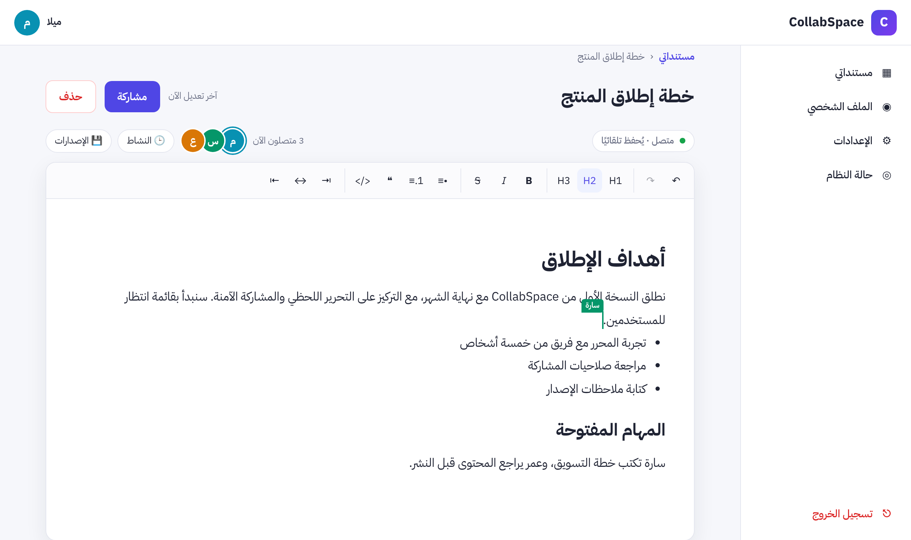
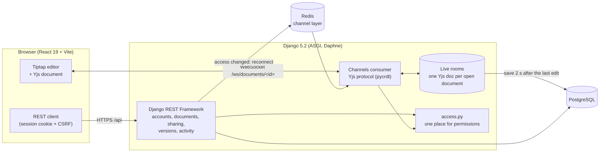
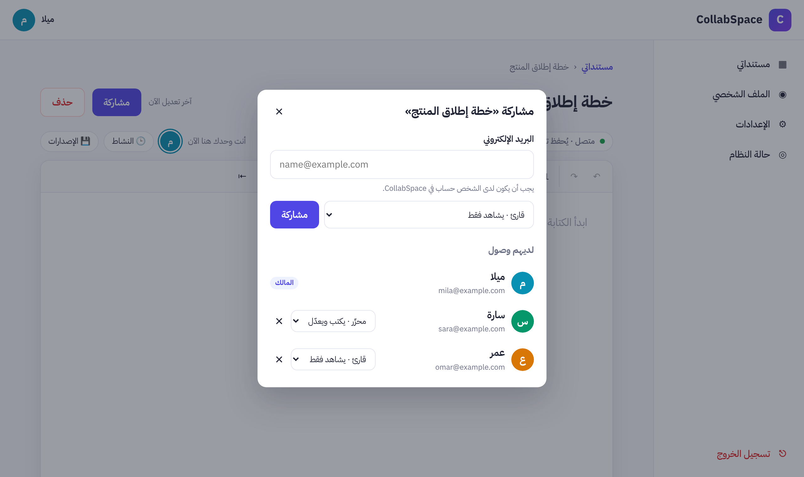
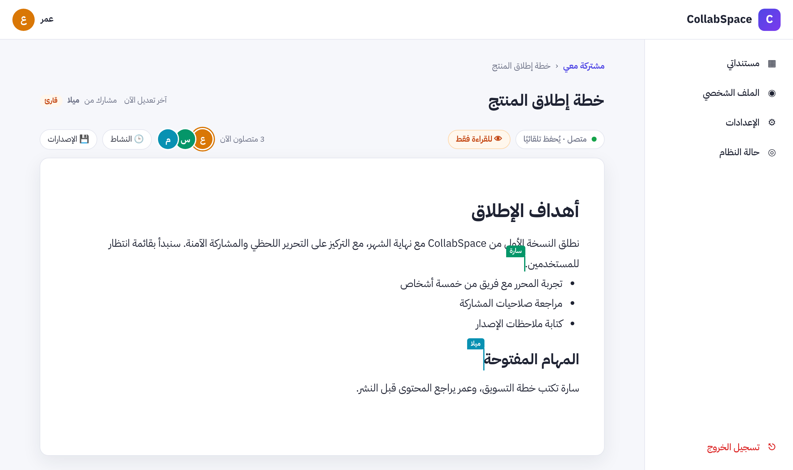
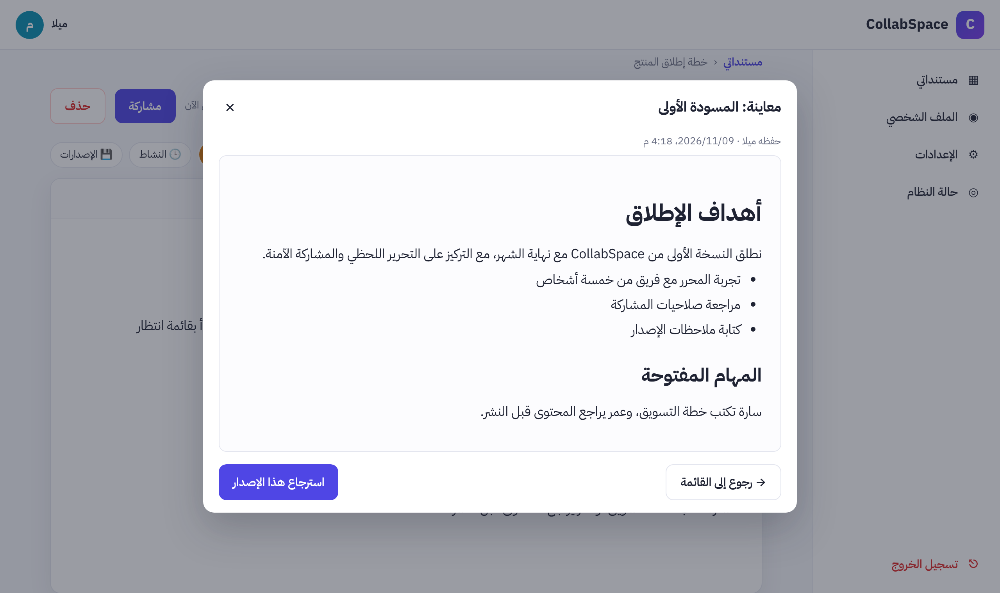
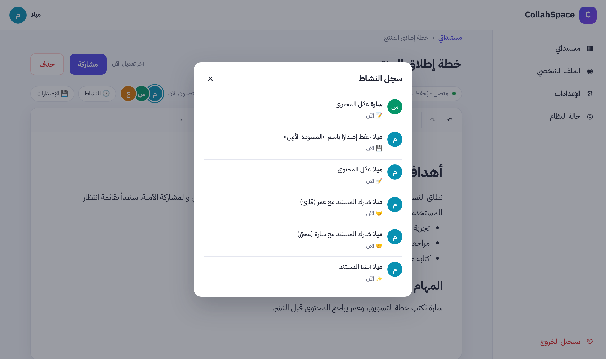

# CollabSpace

**A real-time collaborative document editor**: several people write in the same document at the same time, see each other's cursors, and never overwrite each other's work.

[](https://github.com/maiitlass10/collabspace/actions/workflows/ci.yml)


> محرر مستندات تعاوني لحظي: عدة أشخاص يكتبون في المستند نفسه في الوقت نفسه، يرى كل منهم مؤشرات الآخرين، دون أن يمسح أحد عمل غيره. الواجهة عربية بالكامل (RTL)، وكل فقرة تأخذ اتجاه لغتها تلقائيًا.



## Features

- **Real-time co-editing** with conflict-free merging (Yjs CRDT): rich text, headings, lists, quotes, code, alignment.
- **Presence**: who is in the document right now, with colored, named cursors and selections.
- **Sharing with roles**: owner, editor (writes) or viewer (reads only). Changing or removing someone's access applies **immediately**, without a page reload.
- **Version history**: save named versions, preview any of them, restore one. A backup of the current content is saved first, so a restore can be undone.
- **Activity log**: who created, renamed, edited, shared, or restored what, and when.
- **Accounts**: registration, login, settings (display name, password).
- **Offline-tolerant**: edits made while disconnected are merged when the connection returns.
- **Arabic-first UI** (RTL); Arabic and English paragraphs each take their own direction.

## Architecture



**How an edit travels:** each keystroke becomes a small binary Yjs update. The browser sends it over the WebSocket; the server checks that this user may edit, applies it to the document's live room, forwards it to everyone else in the document, and saves the room to PostgreSQL 2 seconds after the last change (and immediately when the last person leaves). Because Yjs is a CRDT, updates can arrive in any order, even after being offline, and every copy still ends up identical.

## Design decisions

| Decision | Why |
|---|---|
| **Session cookies + CSRF**, not JWT | The session cookie is `HttpOnly` (JavaScript, and so any XSS, can never read it), and it authenticates the WebSocket for free. |
| **Permissions in one module** (`documents/access.py`) | The REST API and the WebSocket ask the same function, so their rules cannot drift apart. |
| **Read-only enforced on the server** | A viewer's tampered browser can send edits; the server ignores them (they are not applied, forwarded, or saved). |
| **404, not 403, for other people's documents** | The API does not even reveal that a document exists. Document IDs are random UUIDs. |
| **Identity set by the server** | The name and color next to a cursor come from the account; whatever the browser claims is replaced, and a connection cannot move another person's cursor. |
| **Instant revocation** | When the owner changes or removes access, the server closes that person's WebSocket (code `4409`); the browser reloads its role and reconnects with the new rights. |
| **Restores go through Yjs** | A restore puts the old content into the live editor, so it reaches everyone through the normal real-time path, respects permissions, and can be undone. |

## Tech stack

**Backend:** Python 3.14 · Django 5.2 LTS · Django REST Framework · Channels + Daphne · pycrdt (Yjs for Python) · PostgreSQL (SQLite for development) · Redis · drf-spectacular (OpenAPI) · WhiteNoise

**Frontend:** React 19 · Vite · React Router · Tiptap 3 · Yjs + y-websocket

**Quality:** 110 backend tests (unit, API, and WebSocket) · Playwright end-to-end tests · GitHub Actions CI · Docker

## Quick start

### Option A: Docker (everything in one command)

```bash
cp .env.example .env     # then set DJANGO_SECRET_KEY and POSTGRES_PASSWORD
docker compose up --build
```

Open http://localhost:8080. Details and production setup: [docs/DEPLOYMENT.md](docs/DEPLOYMENT.md).

### Option B: local development

Requirements: Python 3.11+, Node.js 20.19+ or 22.12+.

**Terminal 1: backend**

```bash
cd backend
python -m venv .venv
# Windows: .\.venv\Scripts\Activate.ps1     macOS/Linux: source .venv/bin/activate
pip install --only-binary=:all: -r requirements.txt
cp .env.example .env     # Windows: copy .env.example .env  (then set DJANGO_SECRET_KEY)
python manage.py migrate
python manage.py runserver
```

**Terminal 2: frontend**

```bash
cd frontend
npm install
npm run dev
```

Open http://localhost:5173. Vite forwards `/api` and `/ws` to Django, so the browser sees a single origin.

## Tests

```bash
cd backend && python manage.py test          # 110 tests: models, API, permissions, WebSocket protocol
```

End-to-end tests: a real browser registers users, shares a document, edits it from two browsers at once, checks read-only mode and instant revocation, and saves and restores a version. Playwright starts its own servers and database, so your development data is never touched:

```bash
cd frontend
npx playwright install chromium   # once
npm run test:e2e                  # with the backend virtualenv activated
```

CI runs all of this on every push, with the backend tests on PostgreSQL, and also builds the Docker images.

## API

Interactive documentation (Swagger UI) is served by the backend at **`/api/docs/`**; the OpenAPI schema is at `/api/schema/`.

| Area | Endpoints |
|---|---|
| Accounts | `GET /api/auth/session/` · `POST /api/auth/register/` · `POST /api/auth/login/` · `POST /api/auth/logout/` · `PATCH /api/auth/profile/` · `POST /api/auth/password/` |
| Documents | `GET, POST /api/documents/` (`?scope=owned\|shared&search=`) · `GET, PATCH, DELETE /api/documents/<id>/` |
| Sharing | `GET, POST /api/documents/<id>/members/` · `PATCH, DELETE /api/documents/<id>/members/<member_id>/` |
| History | `GET /api/documents/<id>/activity/` · `GET, POST /api/documents/<id>/versions/` · `GET /api/documents/<id>/versions/<vid>/` · `POST /api/documents/<id>/versions/<vid>/restore/` |
| Real time | `WS /ws/documents/<id>/` (Yjs sync + awareness protocol). Close codes: `4401` not logged in, `4403` no access, `4409` access changed, `4413` message too large |

## Project structure

```
backend/
  config/          settings, URLs, ASGI (HTTP + WebSocket routing)
  accounts/        custom user (email login), auth API, presence colors
  documents/       documents, sharing (roles), activity log, versions; access.py = permissions
  collaboration/   WebSocket consumer, Yjs protocol helpers, live rooms
frontend/
  src/components/editor/   Tiptap editor, presence, versions, activity
  src/pages/               dashboard, document, settings, auth
  e2e/                     Playwright end-to-end tests
docs/              ERD, deployment guide, screenshots
```

Database schema: [docs/ERD.md](docs/ERD.md).

## Screenshots

| Sharing with roles | A viewer's read-only view |
|---|---|
|  |  |
| **Previewing an old version** | **Activity log** |
|  |  |

## Bugs the tests caught

Some problems only show up under real conditions. These were found by the end-to-end and Docker tests and fixed, each with a regression test:

- **Arabic names broke presence messages.** pycrdt's `Encoder.write_var_string` writes the character count instead of the byte count, so any non-ASCII name corrupted the message. Fixed with our own encoder.
- **Ghost users after Redis was added.** redis-py 8 times out socket reads after 5 s, exactly the time channels-redis blocks waiting for messages. A consumer could crash before its cleanup ran, leaving a "connected" user who had left. Fixed by configuring a longer socket timeout.
- **A version saved right after typing missed the last words.** The HTTP request can overtake the WebSocket messages, and Channels cannot process those messages while a synchronous view runs. The browser now sends its Yjs state with the request, and the server merges it first (Yjs merges are idempotent).
- **After logging in, users landed on the dashboard instead of the page they had asked for**, because two redirects raced.

## Known limitations

- **One backend process.** Live rooms live in the memory of the Daphne process; several processes would need the Yjs state shared between them. See [docs/DEPLOYMENT.md](docs/DEPLOYMENT.md#5-scaling-what-works-and-what-does-not-yet).
- Inviting someone requires that they already have an account (no email invitations).
- In a right-to-left list, an item written in English keeps its bullet on the right.
