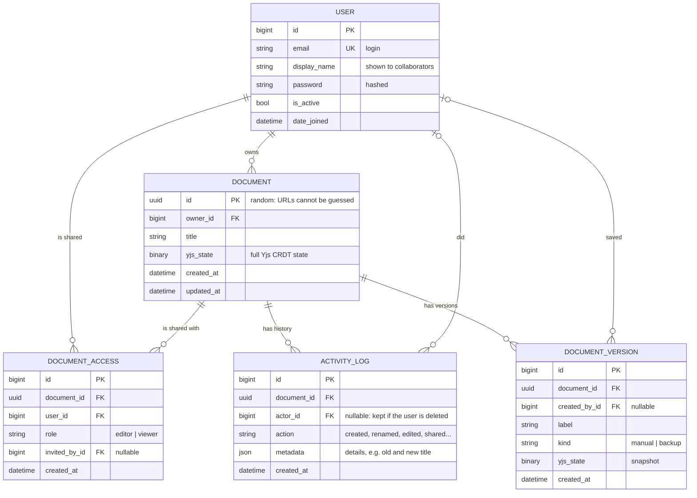

# Database schema (ERD)

GitHub draws this diagram automatically from the text below (Mermaid).

## Rules the schema enforces

| Rule | How |
|---|---|
| One role per person per document | `UNIQUE (document_id, user_id)` on `DOCUMENT_ACCESS` |
| The owner is not stored as a member | Ownership lives on `DOCUMENT.owner_id`; `DOCUMENT_ACCESS` holds only `editor` / `viewer` |
| Deleting a document removes its sharing, history and versions | `ON DELETE CASCADE` from `DOCUMENT` |
| Deleting a user keeps the history readable | `actor_id` / `created_by_id` become `NULL` (`SET NULL`); the UI shows "deleted user" |
| Fast lists and history | Indexes on `(owner_id, updated_at)`, `(document_id, created_at)` |

The live content is a Yjs CRDT state (`yjs_state`), not HTML: that is what lets
several people type at the same time without conflicts.
